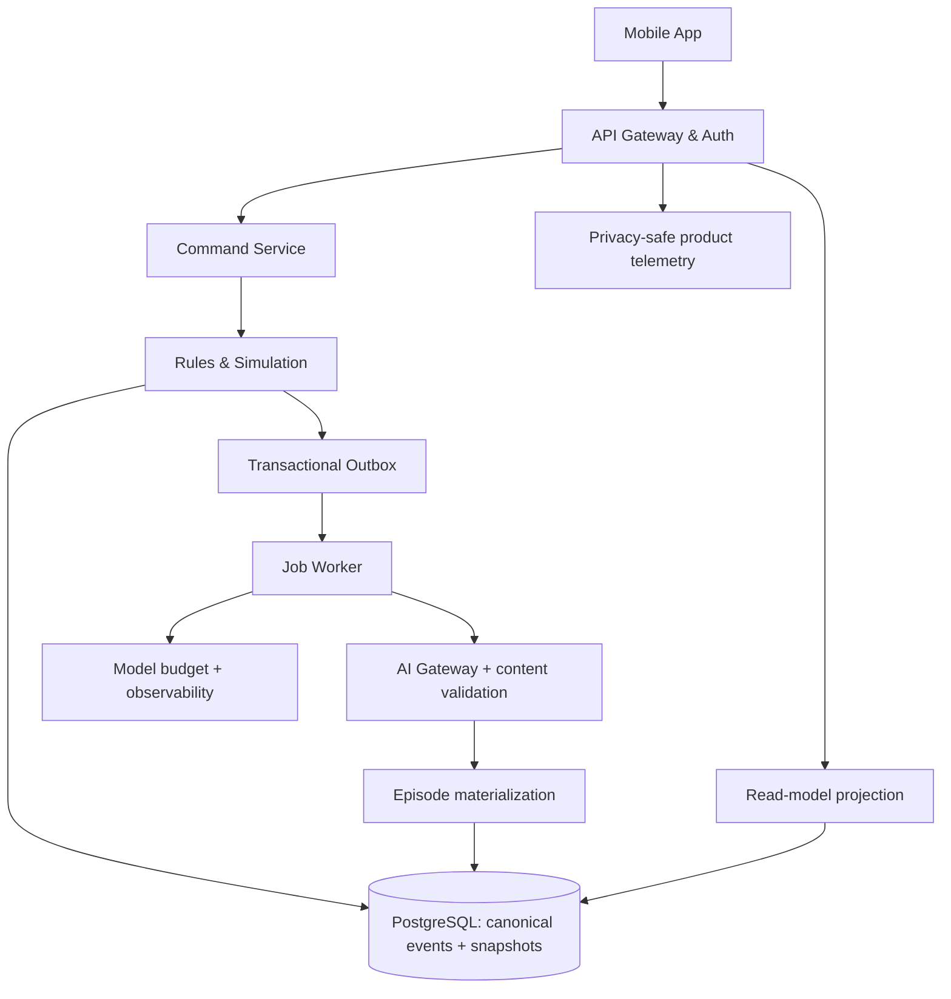

# PUNKGRID — Pre-development Master Documentation v1.0

**Dato:** 11. oktober 2026  
**Status:** Baseline for utvikling; regulatorisk gjennomgang, leverandøravtaler og produktvalidering kreves før offentlig lansering  
**Målgruppe:** Produkt, UX, mobilutvikling, backend, AI/ML, QA, sikkerhet, drift og kommersielt team  
**Tilknyttet normativ spesifikasjon:** `docs/architecture/REALITY_ENGINE_CORE_CONTRACT_v1.0.md`. Ved avvik gjelder Core Contract for simuleringsinvarianter, API, hendelsestilstand og referansefixture; dette dokumentet styrer produktomfang og leveranseprioritet. Avvik skal registreres som ADR i `docs/architecture/adr/` og rettes i begge dokumenter.

> **Beslutningsstatus:** «Vedtak» angir et anbefalt standardvalg teamet kan implementere uten ny produktavklaring, ikke et utsagn om at produktet allerede er bygget. «Hypotese» krever brukertesting. «Gate» må bestås før neste trinn. Kostnader og tidsrammer er foreløpige estimater, ikke tilbud.

---

# 1. Executive Summary / Produktvisjon

**PunkGrid** er en global B2C-app for **vedvarende, interaktive alternative liv**. Brukeren oppretter en privat, fiktiv verden via **Create a Life** eller **Surprise Me**. Hen får en identitet, relasjoner, mål og valgmuligheter. Valgene endrer verdens faktiske tilstand; karakterer og konflikter husker tidligere hendelser; nye episoder bygger på gyldige konsekvenser. Appen er ikke en fri AI-chat, en tradisjonell bok eller en videospillverden i 3D.

**Problem:** AI-fortellinger kan være imponerende ved første møte, men taper verdi når kontinuitet brytes, karakterer glemmer, beslutninger ikke betyr noe og historiene repeterer hverandre. Brukere mangler en lett tilgjengelig mobilopplevelse der de kan eie og videreutvikle et personlig fiksjonsunivers.

**Løsning:** En **Reality Engine** med kanonisk verdensstatus, validerte domenehendelser, karakterkunnskap, årsakssammenhenger, tidsstyring og kontrollert AI-fortelling. Første versjon (A, **Personal Multiverse**) er privat og single-player. Arkitekturen forbereder senere versjon B (**Living Multiverse**) med medlemskap, delt verdensklokke, samtidige handlinger, fraksjoner og sosiale mysterier, men ingen sosial funksjonalitet eksponeres i MVP.

**Unique Value Proposition:** *Live a thousand lives. Every choice matters.* — varige, personlige alternative liv med etterprøvbare konsekvenser, ikke bare tekst som improviseres fra gang til gang. Konkurransefordelen er foreløpig en **produkt- og teknologihypotese**, ikke dokumentert «moat».

**Primærmålgruppe:** Engelskspråklige 18–35-åringer som bruker interaktiv fiksjon, rollespill, spill og AI-kreativitetsapper; initialt markedsfokus på USA, Storbritannia og andre engelskspråklige segmenter. **Sekundær:** 25–44-åringer som liker alternative liv, narrativ utforskning, mysterier og lett tilgjengelig gaming. Ingen påstand om at disse segmentene er validert.

**North Star Metric (NSM):** **Weekly Meaningful World Sessions (WMWS)** = antall unike brukere per uke som gjennomfører ≥2 kanonisk betydningsfulle beslutninger fordelt over ≥2 økter i en aktiv verden. Kvalifiserende beslutninger må gi en varig tilstandsendring eller en eksplisitt gyldig konsekvens, ikke bare mer tekst.

**MVP-hypoteser og beslutningsmål:** førstegangsspill innen 3 minutter (p75), D1 ≥35 %, D7 ≥20 %, D30 ≥10 % (brukerkohorter; foreløpige forsøksgrenser), ≥65 % av aktiverte fullfører 1. episode, ≥50 % oppgir at egne valg påvirket senere episoder; null kritiske autorisasjons- og kanoniske konsistensfeil i release-gate. Kostnad per aktiv bruker, betalingsvilje og retensjon skal måles, ikke antas.

---

# 2. Product Requirements Document (PRD)

## 2.1 Bakgrunn, mål og strategiske vedtak

**Problemhypotese P1:** brukere søker utforsking av alternative identiteter og liv med lav terskel. **P2:** konseptet oppleves vesentlig mer verdifullt når tidligere beslutninger får vedvarende konsekvenser. **P3:** en daglig Surprise Me-mekanikk kan forbedre gjenbesøk uten tilfeldige, lite plausible hendelser. **P4:** arkitektur for delte verdener kan forberedes uten å ta med multiplayer i MVP. Alle krever validering.

**Mål:** demonstrere faktisk kausal simulering; nå god brukeropplevelse i første økt; bygge privat, sikker og kostnadsstyrt AI-app; skape evidens for gjentatt bruk og betalingsvilje; holde fremtidig B teknisk mulig.

**Ikke-mål:** simulere livet vitenskapelig eller predikere reelle fremtidsutsikter; terapi, rådgivning, utdanning med historisk garanti, ubegrenset AI-rollespill, åpen sosial plattform, sanntidsverdener på server, generativ video, AR/VR, brukerhandel, kryptovaluta, anonyme chatter eller å kopiere reelle personers identitet.

**Besluttede MVP-standarder:** 18+ første release, engelsk, iOS + Android, portrettorientert mobilapp, mørk visuell profil med tilgjengelig lys-/høykontrastmodus, private verdener, én aktiv gratisverden (kvoten håndheves atomar i `world.create`-transaksjonen mot entitlements, ADR-012), guidede valg (2–4, se ADR-012 for harmonisering mot Core Contract §5), episoder primært i tekst med enkelte forhåndsgodkjente/AI-bilder innen budsjett, freemium med betaling når mekanikken er validert, ingen offentlig deling av innhold i MVP. Innlogging kan utsettes til etter lokal gjeste-preview, men serverlagring krever konto/ephemeral guest identity med planlagt oppgraderingsløp.

## 2.2 In Scope / Out of Scope

| Område | A MVP: In scope | Etter MVP / Out of scope |
|---|---|---|
| Opprettelse | Create a Life; Surprise Me; validerte startmaler | Åpent ubegrenset prompt-basert world creation |
| Gameplay | Scener, 2–4 valg, konsekvenser, episodisk videreføring | Fri improvisasjon som kan endre regler |
| Verdensmodell | Privat verden, identitet, NPC-er, relasjoner, ressurser, tidslinje, story arcs | Delte verdener, global kanon og markedsplasser |
| Hukommelse | Kanonisk state, fakta, kunnskapsfiltre, hendelseslogg | Ukontrollerte autonome minner |
| Overraskelser | Én budsjettstyrt Surprise Engine og cooldown | Global tilfeldig hendelsesstrøm |
| Tid | Bounded catch-up på resume, begrensede schedulers | Kontinuerlig agent-simulering |
| Media | Tekst, illustrasjoner som valgfritt tillegg | Video, 3D, stemmekloning |
| Sikkerhet | Rapportering av AI-innhold, filtre, aldersport, sletting, konto | Offentlig profil/chat/moderering mellom mennesker |
| Inntekt | Gratis + testbart premium-entitlement, plattformbetaling | Bruker-til-bruker handel |

## 2.3 Detaljerte brukerpersonas

**Persona 1 — Maya (24), narrativ spiller:** Mobilspill 10–20 minutter om kvelden; bruker interaktive historier og fandom-plattformer. Motivasjon: oppleve at egne valg teller. Frustrasjon: gjentakende plot og «fake choices». Behov: første scene på under tre minutter, konsekvenslogg, korte kapitler, tydelig avslutning. Suksess: vender tilbake neste dag for å se hva som endret seg. Risiko: faller av ved langsom AI eller inkonsistens.

**Persona 2 — Jordan (31), alternativ-liv-utforsker:** Har hektisk jobb, liker science fiction og «what if»-fortellinger, men identifiserer seg ikke som gamer. Motivasjon: oppleve et annet liv uten komplisert spillgrensesnitt. Frustrasjon: overveldende onboarding og kompliserte stats. Behov: Surprise Me, lesbar tekst, valg med klar innsats, pauser/gjenopptak. Suksess: gjennomfører tre episoder i sin første uke.

**Persona 3 — Amara (28), mystery/roleplay-entusiast:** Bruker sosial gaming og fortellingsapper. Motivasjon: langvarige karakterbuer, skjulte sammenhenger og senere samarbeid. Frustrasjon: NPC-er som vet ting de ikke burde, og plot som ikke husker. Behov: stabile relasjoner, konsekvent karakterkunnskap, mysterier med ekte beviskrav. Suksess: ønsker å invitere andre til en fremtidig delt verden. I MVP gis ingen sosial funksjon som ennå ikke er trygt moderert.

## 2.4 Viktigste user journeys

**J1 — Oppdagelse og aktivering:** Landingsside/appbutikk → installer → 18+-port/personvern kort forklart → velg Create a Life/Surprise Me → 2–3 valg om verden og persona (Surprise Me hopper over) → verdensblueprint valideres → episode 1 lastes → bruker gjør minst ett meningsfullt valg → konsekvenssynlig kvittering → valgfri konto/lagre. Feilgren: timeout gir samme gyldige episode via fallback, ikke tapt verdensstatus.

**J2 — Gjenbesøk:** Åpne app → autentisert profil/verdensoversikt → resume beregner bounded catch-up → «Since you were away»-kort (kun kanoniske hendelser) → les episode → velg → kort konsekvensmelding → neste episode i kø → returner når klar.

**J3 — Surprise Me:** Aktiv verden → trykk Surprise Me → sjekk cooldown/budsjett/gyldige hendelsesfamilier → kandidat evalueres mot regler → commit/gyldig no-op → episode knyttet til hendelse → vis konsekvens. Det skal ikke finnes «betalt reroll» som omgår sikkerhetsregler.

**J4 — Betaling:** Brukeren forsøker å opprette ekstra aktiv verden → tydelig betalingsskjerm med pris, rettigheter og fornyelse → plattformbasert kjøp → server verifiserer entitlement → verden kan opprettes → Restore Purchases virker. Ved feil fortsetter eksisterende gratisverden uendret.

**J5 — Personvern og feilrapport:** Profil → Privacy → se informasjonskategorier, last ned eksport, slett konto; ved problem i scene → Report content → velg type, send → bekreftelse → modereringskø (ingen garanti for øyeblikkelig handling); blokkér upassende tema via content preferences.

## 2.5 Funksjonelle krav, med ID og testbar definisjon

| ID | Prioritet | Krav / kontrakt | Godkjenningssignal |
|---|---|---|---|
| FR-01 | Must | To innganger Create a Life / Surprise Me | Samme domeneformat for begge |
| FR-02 | Must | Validerte kombinasjoner identitet/tid/sted | Inkompatibel kombinasjon avvises uten verden |
| FR-03 | Must | Private, vedvarende verdener | Resumert state har samme hash som lagret |
| FR-04 | Must | 2–4 serverutstedte gyldige valg per scene | Ugyldig choice ID = 422 uten commit |
| FR-05 | Must | Domeneregler før kanonisk mutasjon | AI-tekst kan ikke påvirke state direkte |
| FR-06 | Must | Relasjoner/ressurser/arc-status | Synlig, testbar deltakelse i handlinger |
| FR-07 | Must | Kausal event-ledger + snapshots | Deterministisk replay |
| FR-08 | Must | NPC-kunnskap filtrert per perspektiv | Ingen uautorisert hemmelighetslekkasje |
| FR-09 | Must | Generering med timeout/retry/fallback | Ingen dupliserte commits |
| FR-10 | Must | Resumert verdensklokke med tak | Ingen ubegrensede catch-up-jobber |
| FR-11 | Must | Rapportér AI-innhold, tema-/sikkerhetsfiltre | Rapport oppretter support/moderingssak |
| FR-12 | Must | Konto/tilgang/RLS, sletting/eksport | Negativt tverrbrukertestsett bestått |
| FR-13 | Must | Kost-/token-logg og per-bruker hard caps | Provider-kall stoppes ved budsjett |
| FR-14 | Must | Telemetri aktivering, episode, D1/D7/D30 | Events spores uten historietekst som standard |
| FR-15 | Must | Tilgjengelig, responsiv mobilopplevelse | Kritiske flater manøvrerbare med skjermleser |
| FR-16 | Should | Illustrasjoner for sentrale episoder | Asynkront og ikke blokkerende |
| FR-17 | Should | Betalt tier + gjenoppretting av kjøp | Plattformkvittering verifisert server-side |
| FR-18 | Should | «Your choices mattered»-visning | Refererer faktiske event-IDs |
| FR-19 | Should | Interne kvalitetsevalueringer per prompt/regler | Eval-rapporter i CI |
| FR-20 | Could | Alternative tema-/typografimoduser | Bruker kan lagre visningspreferanse |
| FR-21 | Future | Verdensmedlemskap >1 aktiv deltaker | Isolert feature flag, ikke MVP |
| FR-22 | Future | Delt verdensklokke/konfliktløser | Egen ADR og sikkerhetsgate |

## 2.6 Ikke-funksjonelle krav

| ID | Krav | Mål ved beta | Målemetode |
|---|---|---|---|
| NFR-01 | API-responstid | p95 <500 ms for databasebaserte GET; generering asynkron | APM, syntetiske tester |
| NFR-02 | Første scene | p75 <20 s etter opprettelse; UI viser status/fallback | RUM/telemetri. Målekal sett: commit → episode `published`/`fallback`, via `episode_generation_finished` (ADR-013). «Førstegangsspill ≤3 min» er en separat aktiveringsmetric (app_opened → første choice_committed), jf. §1/§2.1 |
| NFR-03 | Oppetid | ≥99,5 % beta for kjerne-API, ekskl. varslet vedlikehold | Uptime monitor |
| NFR-04 | Dataintegritet | 0 tapte commits, 0 ikke-deterministiske replayfeil | Fault-injection og replay |
| NFR-05 | Autorisasjon | 0 tverrbrukerlesninger/-skrivinger i sikkerhetstester | Pen-test og RLS-test |
| NFR-06 | Robusthet | Retry av identisk kommando uten duplikat | Idempotens-suite |
| NFR-07 | Tilgjengelighet | WCAG 2.2 AA som designmål der relevant | Accessibility audit på begge OS |
| NFR-08 | Lokalisering | All UI-copy eksternt nøkkelstyrt | i18n lint |
| NFR-09 | Observability | Request ID, world ID pseudonymt, versjon, latency, tokenkostnad | Dashboard og traces |
| NFR-10 | Kostnad | Varsling + hard cap før provider-spend; målt brutto bidrag | Faktiske modellpriser og brukskohorter |
| NFR-11 | Gjenoppretting | DB PITR/backups og øvd restore; fastsett RPO ≤24 t/RTO ≤8 t for beta | Restore-drill |
| NFR-12 | Kapasitet | Lasttest 1 000 samtidige økter, simulert generering | Load-test med bounded workers |

Målene er **prosjektkrav**, ikke dokumentert ytelse.

## 2.7 Avhengigheter og risikoer

| Risiko | Sannsynlighet / konsekvens | Mitigering | Eier |
|---|---|---|---|
| R1: historiene føles generiske | Høy / svært høy | Manuelt kuratert referanseverden, differensieringstest, writer review | Produkt/Content |
| R2: inkonsistent verdenskanon | Middels / svært høy | Hendelseslogg, regler, versjonerte snapshots, golden suite | Backend lead |
| R3: AI-kostnad overskrider ARPU | Høy / høy | Tekst først, budsjett, cache, modellrouting, hard caps | Tech/Finans |
| R4: dårlig D7-retensjon | Høy / høy | A/B-test kausal kontinuitet vs baseline, bedre episodeavslutninger | Produkt/Growth |
| R5: farlig eller uegnet generering | Middels / svært høy | Aldersport 18+, moderering, brukerreport, scenarioavgrensning | Trust & Safety |
| R6: GDPR/overføring av data | Middels / svært høy | DPIA-screening, DPA, minimering, EU-behandling der valgt, sletterutiner | Privacy |
| R7: appbutikkavvisning | Middels / høy | Policytest AI-innhold, IAP, aldersmerking, supportlink | Release manager |
| R8: «B-ready» gjør MVP treg | Høy / middels | Reserver bare strukturelle grensesnitt; ingen multiplayer-runtime | Arkitekt |
| R9: vendor lock-in/modellregresjon | Middels / høy | Modelladapter, låste evalueringer, rollback, versjoner | AI lead |
| R10: lovet «virkelighets»-simulering misforstås | Middels / høy | Fiksjonsmerke, ingen prediksjonspåstander, eksplisitte grenser | Product/Legal |

---

# 3. Feature Breakdown & prioritering

**Kompleksitet:** S = 1–3 utviklerdager, M = 4–8, L = 9–18, XL = 19–35+ inklusive grunnleggende tester; usikkerhet ±50 %, avhengig av team. Must=utviklingssperre for MVP; Should kan utsettes til betalingsbeta.

| Feature ID | Funksjon / brukerverdi | MoSCoW | Str. | Avhengighet |
|---|---|---|---|---|
| F01 | Onboarding + 18+-port; rask og trygg start | Must | M | Auth/policy |
| F02 | Guest preview → konto; lav registreringsfriksjon | Must | M | F01 |
| F03 | World Genesis-mal og validering; plausibel start | Must | L | Core |
| F04 | Create a Life; kontroll over WHO/WHERE/WHEN | Must | M | F03 |
| F05 | Surprise Me-start; oppdagelse på ett trykk | Must | M | F03 |
| F06 | World home / resume; varig tilknytning | Must | M | F03/F08 |
| F07 | Episode reader / choice cards; kjernespill | Must | L | F08/F10 |
| F08 | World state + event-sourcing light; konsistens | Must | XL | DB |
| F09 | Regelmotor/konsekvens/relasjoner; meningsfulle valg | Must | XL | F08 |
| F10 | AI-narrasjon + schema validation/fallback; kvalitet | Must | XL | F09 |
| F11 | Memory + POV-kunnskap; kontinuitet | Must | L | F08 |
| F12 | Surprise Engine med cooldown; spenningskurve | Must | L | F09/F11 |
| F13 | Time/catch-up ticks; verden mellom besøk | Must | L | F08/F09 |
| F14 | Rapportering, moderering og sikkerhetsfilter | Must | L | F10 |
| F15 | Sletting/eksport/personvernkontroll | Must | L | DB/Auth |
| F16 | Analyse av aktivering, D7, kostnader | Must | M | Event spec |
| F17 | Feature flags + config; trygg utrulling | Must | S | Hosting |
| F18 | Betaling/free limits/entitlements | Should | L | Auth/IAP |
| F19 | Episodebilder/cache | Should | M | F10/Media |
| F20 | Konsekvensoversikt / beslutningsjournal | Should | M | F08 |
| F21 | Varslinger etter samtykke | Could | M | Scheduler |
| F22 | Sosial deling av ikke-sensitive promo-kort | Could | M | Privacy |
| F23 | Multiplayer + organisasjoner | Won't MVP | XL | B-gate |
| F24 | Video, AR/VR, public content | Won't MVP | XL | Strategy |

**MVP-grense:** F01–F17. F18 kan ligge bak feature flag inntil betalingsbeta. Ikke lov å kalle gratisprototypen «freemium-lansert» før kjøpsflyten er testet. F19–F22 legges inn bare hvis kjernekravene består.

## Roadmap og exit-kriterier

| Milepæl | Leveranse | Gate |
|---|---|---|
| M0 Discovery | Konsepttest, instrumenteringsplan, referanseworld, UX-prototype | Minst 15 modererte tester; identifiser første verdiforståelse |
| M1 Core alpha | Canonical simulation, rulepack, golden test, AI-fortelling | 20/20 golden scenarier, replay og negative kontroller |
| M2 Mobile private alpha | F01–F17, iOS/Android test-build, 30–50 voksne testere | Ingen P0/P1-feil; telemetry komplett; brukbar første episode |
| M3 Closed beta | 200–500 testere; betalingsforsøk, kostoptimalisering | D7 og verdiopplevelse evalueres; enhetsøkonomi vurderes |
| v1.1 | Bedre verdensmaler, consequence journal, premium, bilder | Retensjon og margin forbedres |
| v2.0 (B pilot) | Invitasjonsverden og 2–5 spillere i kontrollert pilot | Separat ADR, moderering, samtidighets- og privacy-gate |

**Kill/pivot-gate:** Dersom D7 <10 % etter to målbart forbedrede beta-iterasjoner og brukertester ikke viser reell differensiering, stopp full B-utvikling og revurder produktløftet. Ikke «løse» dette med flere AI-modeller.

---

# 4. Teknisk arkitektur & anbefalinger

## 4.1 Valgt stack

| Lag | Anbefalt | Begrunnelse / alternativ |
|---|---|---|
| Mobil | React Native + Expo + TypeScript | Én kodebase, rask iterasjon, OTA-policy kontroll; alternativ Flutter ved teamstyrke |
| API | TypeScript Node.js (Fastify eller NestJS; **NestJS default**) | Modulære domenegrenser, validering, testbarhet |
| Hosting | EU-region på managed containerplattform; **AWS eu-central-1** default | Kontroll over workers, nettverk og observability; Vercel alene ikke nødvendig |
| DB/Auth | Supabase PostgreSQL + Auth i EU-region | Transaksjoner, RLS, realtime-vei; backend håndhever autorisasjon |
| DB tilgang | SQL/migrasjoner + Kysely eller Prisma; **Kysely default** | Eksplisitte transaksjoner, typekontroll, lite domenemagi |
| Jobs | Postgres outbox + bounded worker; managed queue ved skalering | Få komponenter i MVP, idempotente jobber |
| Storage | Privat objektlagring, kryptering, signerte URL-er | Bilder/eksporter uten offentlig bucket |
| AI gateway | Server-side provider adapter med strict schemas | Bytt modell, sett budsjett, isoler leverandør |
| Analytics | PostHog EU eller tilsvarende, privacy-safe events | Kohorter/eksperimenter; ingen rå episodeprosa i analytics |
| Error/Observability | Sentry + OpenTelemetry + dashboard | Crash, latency, cost, trace |
| Purchases | RevenueCat + Apple/Google IAP | Rettigheter, restores; server-verifisering |
| CI/CD | GitHub Actions + signerte builds + migrations gate | Sikker, automatisert release |
| Infra as code | Terraform/Pulumi, **Terraform default** | Reproduserbar staging/prod |

**Ingen leverandørtilknytning er besluttet kommersielt** før DPA, datalagringssted, underdatabehandlere, kostnader og tekniske vilkår er gjennomgått.

## 4.2 Logisk arkitektur



**Oppretting:** bruker -> auth -> validert blueprint -> transaksjon world/owner membership/genesis event -> episode pending -> outbox -> modellgateway -> schema + canon validation -> published/fallback. **Valg:** klientens `choiceId` + forventet worldVersion + idempotency key -> tilgangskontroll -> lås world row -> regelovergang -> event + snapshot + outbox i samme transaksjon -> commit -> narrasjon uten å kunne endre kanon. **Resume:** bounded ticks med world-local clock; ingen globale AI-agenter.

## 4.3 API, domene og versjonering

Core Contract definerer de **10 normative `/v1`-endepunktene**, `worlds`, `world_memberships`, `identities`, `world_events`, `world_snapshots`, `narrative_episodes` m.fl. og tilstandsmaskiner. Ikke introduser parallelle APIs her. Alle state-mutasjoner har `commandId`, `expectedWorldVersion`, `Idempotency-Key`; konflikt = `409 WORLD_VERSION_CONFLICT`; gjenbruk med annet payload = `409 IDEMPOTENCY_PAYLOAD_MISMATCH`. Server beregner actor fra autentisering, aldri fra klientleverte owner-felt. Returner ikke eksistens til uautorisert aktør.

**Schema governance:** SQL- og JSON-kontrakter versjoneres, API bakoverkompatibilitet testes, migrations er additive før eventuell drop. Promptversjon, regelpakke, world blueprint og modellinnstillinger lagres per generation run. Regelendringer påvirker ikke gammel verdenshistorie uten eksplisitt migreringsprosedyre.

## 4.4 Sikkerhet og personvern

- Data-minimering: Samle ikke fødselsdato utover nødvendige aldersport-signaler; ikke krev faktisk navn, bilde, telefon eller virkelige personlighetstrekk.
- Privacy by default: private verdener, pseudonyme IDs, privat lagring, kryptering in transit/at rest, minst mulige IAM-rettigheter, secrets manager, rotated keys.
- GDPR: rettslig grunnlag per formål, Art. 13/14-informasjon, databehandleravtaler, innsyn/portabilitet/sletting, retention schedule, overføringsgrunnlag ved tredjeland, DPIA-screening og eventuell DPIA før skalering/sosial funksjonalitet. CCPA/CPRA-review før aktiv California-lansering. Dette er implementeringskrav, ikke juridisk konklusjon.
- AI: policy filter før/etter generering, prompt-injection guardrails, faktakontroll mot kanon, eksplisitt AI-/fiksjonsmerking, menneskelig klagebehandling, ikke konstruere uautoriserte virkelige personer eller gi villedende reelle spådommer.
- Google Play krever in-app rapportering/flagging for AI-generert innhold; Apple krever egne kontroller for visse former for brukerinnhold og regulerer kjøp av digitalt innhold. Se kilder sist.
- Tilgang: autorisasjon for world og episodes i API og DB-policy. Verdensmedlemskap designes nå; `mode=personal, visibility=private` håndheves som MVP-invariant.
- Slettearkitektur: Besluttet i ADR-014 (Proposed inntil juridisk godkjenning): hard-/crypto-sletting av all PII-bærende verdenstilstand innen 30 dager; eneste varige spor er PII-fri audit-post (`account_id`, pseudonym `world_id`, tidspunkt, utfall). For privat A kan hele verden hard-slettes; B må ha eksplisitt isolering av bruker-PII fra kanonisk, delt verdenshistorie før pilot.
- Driftsikkerhet: SAST/DAST, dependency scans, dependency pinning, rate limiting, WAF etter behov, backups, restore drill, incident runbook, abuse-report SLA.

## 4.5 Kritiske beslutninger / ADR-register

| ADR | Vedtak | Trigger for revisjon |
|---|---|---|
| ADR-001 | PostgreSQL er autoritativ; AI aldri write-access | Aldri uten ny sikkerhetsgjennomgang |
| ADR-002 | Modulær monolitt fremfor mikroservices | Workerlast eller organisatorisk skala |
| ADR-003 | Strict bounded choices før fri tekst | Etter dokumentert sikkerhets-/konsistensgate |
| ADR-004 | Verdenseier != identitet != medlemskap | Ingen |
| ADR-005 | Hendelseslogg + snapshot atomisk | Ingen |
| ADR-006 | Async episode generation, stable status polling | Endre til streaming kun uten canon-brudd |
| ADR-007 | Private worlds only in A | B-gate |
| ADR-008 | Modelladapter og provider budget før generering | Pris og kvalitetsmåling |
| ADR-009 | Aldersport 18+ i første offentlig release | Juridisk/produktmessig godkjent endring |
| ADR-010 | World clock separat fra real time | Ingen |
| ADR-011 | Client-/plattformstack-defaulter (§4.1) formellisert | Leverandør-DPA/kostnad |
| ADR-012 | Harmonisering: 2–4 valg overalt; gratisverdenskvote atomar i world.create | Ingen |
| ADR-013 | Målesemantikk: NFR-02-latens vs aktiveringsandel er to ulike målekal | Ingen |
| ADR-014 | Sletting: hard/crypto-slett av world-data + PII-fri audit-post; Proposed inntil Privacy/Legal godkjenner | Juridisk gate |

Fullstendig register: `docs/architecture/adr/`.

## 4.6 Risiko for teknisk kompleksitet

**Høyeste usikkerhet (XL):** kausal regelmotor, kunnskapsfiltrert AI-narrasjon, pålitelig fallback/replay og dramaturgisk originalitet. **Middels:** mobilapp, opprettelse, rapportering, kjøp, analytikk. **Fremtidig XL:** samtidighet, moderering og rettigheter i flerbrukerverdener. Ikke bygg prototypen som ett gigantisk prompt med lokal JSON som eneste verdensstatus.

---

# 5. UX/UI-retningslinjer & informasjonsarkitektur

## 5.1 Designprinsipper

1. **Experience before configuration:** spillbar scene ≤3 minutter; ikke flertrinns-personlighetstest.
2. **Agency made visible:** brukerens valg vises med konsekvens, men uten å avsløre alle hemmeligheter.
3. **Mystery without deception:** klart merket som fiksjon og generert innhold; ikke lat som virkelig person/forhold.
4. **Readable and calming:** mobiltypografi, dynamisk skriftstørrelse, høy kontrast, tekst-først og redusert bevegelse.
5. **One primary action:** én dominerende CTA per skjerm; valgalternativer skal være tydelige og tilgjengelige.
6. **Continuity as UI:** «Previously», «Since last visit» og reell decision journal, uten falsk kausalitet.
7. **Privacy by design:** profil/sletting/reporting tilgjengelig uten skjult meny.

## 5.2 Informasjonsarkitektur / sitemap

```text
App
├── Welcome / age gate / privacy summary
├── Preview / sign-in / account upgrade
├── Home
│   ├── Active world card → World overview
│   │   ├── Episode reader
│   │   ├── Choose action / Surprise Me
│   │   ├── Episode loading / fallback
│   │   ├── Previously / consequences
│   │   └── World facts / characters (bounded)
│   └── Create a Life / Surprise Me Genesis
├── Library (archived worlds and episode history)
├── Premium (behind feature flag)
└── Profile & Settings
    ├── Reading / accessibility / content preferences
    ├── Privacy / data export / delete account
    ├── Report content / support
    └── Subscription / restore purchases
```

## 5.3 Nøkkelskjermer

| ID | Skjerm | Innhold | Primærhandling |
|---|---|---|---|
| UI01 | Welcome | Visuelt portalmotiv, verdi, fiksjonsmerke | Enter |
| UI02 | Genesis choice | Create a Life + Surprise Me | Select |
| UI03 | Guided world setup | WHO/WHEN/WHERE + premissvisning, bounded valid options | Create world |
| UI04 | World opening | Tittel, kontekst, 1. scene, 2–4 valg | Choose |
| UI05 | Episode reading | Kort scene, NPC, fakta relevant for POV, lettlest tekst | Advance |
| UI06 | Choice outcome | Beslutningskvittering, konsekvenshint | Continue |
| UI07 | World home | Current arc, time, relationship hints, resume | Resume world |
| UI08 | Surprise | Status/cooldown, gyldig uventet hendelse | Surprise Me |
| UI09 | History | Tidligere episoder, konsekvenser | Open episode |
| UI10 | Account & Privacy | Eksport, sletting, content settings, reporting | Save / submit |
| UI11 | Paywall | Transparent plan/limits/fornyelse | Subscribe/Restore |
| UI12 | Error states | Offline, timeout, generation pending, budget reached | Retry/poll/return |

## 5.4 Tekstlige wireframes

**A — Welcome / discovery**

```text
┌──────────────────────────────┐
│ PUNKGRID                     │
│ [Portal artwork]             │
│ Your reality is only one ... │
│ [ Create a Life ]            │
│ [ Surprise Me ]              │
│ Fictional AI-generated worlds│
│ Privacy · 18+ · Sign in      │
└──────────────────────────────┘
```

**B — Episode and choice**

```text
┌──────────────────────────────┐
│ ←  The Glass Harbor     ⋯    │
│ Singapore · 2034 · Episode 3 │
│ [Optional scene illustration]│
│ Short readable paragraphs... │
│ [ Choice 1: Investigate ]    │
│ [ Choice 2: Confront ]       │
│ [ Choice 3: Negotiate ]      │
│ Report · Previously · Save   │
└──────────────────────────────┘
```

**C — World overview**

```text
┌──────────────────────────────┐
│ MY WORLD: THE GLASS HARBOR   │
│ Status: Active | Day 3       │
│ Main arc: Acquisition       │
│ Since last visit: 1 event    │
│ Relationship: Mara (changed) │
│ [ Continue story ]           │
│ [ Surprise Me ] cooldown     │
│ Episodes · Characters · More │
└──────────────────────────────┘
```

## 5.5 Designsystem v0

**Farger (forslag, må kontrasttestes):** Ink `#0D1223`, Surface `#18213A`, Raised `#24314E`, Primary Violet `#A58BFA`, Accent Cyan `#70D8EB`, Text `#F5F7FF`, Muted `#BDC8E1`, Danger `#FF8F99`, Success `#8BE0B0`. Status aldri bare formidlet gjennom farge. **Typografi:** Inter eller systemfont for UI; tilgjengelig lesemodus med en serif som eksempelvis Source Serif 4 (lisens må kontrolleres); tekstskala 12/14/16/20/24/32 med dynamisk skalering. **Spacing:** 4/8/12/16/24/32. **Radius:** 8/12/20. **Komponenter:** Button, ChoiceCard, WorldCard, EpisodeText, ProgressSkeleton, StoryStatus, ConsentDisclosure, PrivacyRow, ReportSheet, SubscriptionCard, Toast, ErrorPanel. **Animation:** forsiktig portal-overgang 200–350 ms, full reduced-motion støtte, aldri blokker lesing.

**Responsivt:** mobil 320–430 dp, nettbrett som bonus. Orientering portrait i MVP; tastatur og skjermleser må støttes, trykkmål minst plattformstandard. Figma-fil og tokenpakke lages etter godkjent interaksjonsprototype.

---

# 6. Brukerhistorier / Acceptance criteria

Akseptansekriterier i **Given / When / Then**-format. ID-er er stabile for Jira/Linear og QA.

| ID | Brukerhistorie | Prioritet | Viktigste akseptansekriterium |
|---|---|---|---|
| US01 | Som ny bruker vil jeg forstå PunkGrid på første skjerm slik at jeg vet hva produktet gjør. | Must | Given fresh install, When welcome opened, Then fiction/AI-merke + to innganger vises. |
| US02 | Som ny bruker vil jeg bruke Surprise Me slik at jeg kan starte uten oppsett. | Must | Valid world opprettes med servervalidert blueprint; åpningsepisode tilbys. |
| US03 | Som utforsker vil jeg velge rolle, tid og sted slik at verdenen passer min interesse. | Must | Uforenlig kombinasjon avvises med forklaring; ingen halvskapt world. |
| US04 | Som spiller vil jeg ha flere gyldige valg slik at jeg kan påvirke handlingen. | Must | 2–4 serverutstedte valg bundet til aktuell versjon. |
| US05 | Som spiller vil jeg at beslutninger lagres slik at de påvirker senere episoder. | Must | Etter commit finnes event og endret snapshot; replay samsvarer. |
| US06 | Som spiller vil jeg kunne fortsette etter å ha lukket appen slik at jeg ikke mister progresjon. | Must | World rehydreres og siste episode/valg tilgjengelig. |
| US07 | Som spiller vil jeg forstå konsekvensene av et valg slik at mine handlinger føles meningsfulle. | Must | Vis kort konsekvens basert på committed event, ikke AI-gjetning. |
| US08 | Som spiller vil jeg at karakterene husker relevant historie slik at relasjoner oppleves ekte. | Must | NPC kan bare omtale faktiske tillatte facts; negative secrecy-tester. |
| US09 | Som spiller vil jeg møte overraskelser som gir mening slik at jeg blir nysgjerrig. | Must | Kun gyldige hendelsesfamilier; cooldown; no-op hvis ingen gyldige. |
| US10 | Som spiller vil jeg se hva som skjedde siden sist slik at gjenbesøk er givende. | Must | Bounded catch-up med bare committed world events. |
| US11 | Som bruker vil jeg kunne pause/arkivere verdenen slik at jeg styrer opplevelsen. | Must | Statusmaskin respekteres; arkivert verden kan ikke muteres. |
| US12 | Som bruker vil jeg vite at verdenen er fiksjon slik at jeg ikke blir villedet. | Must | Merking i onboarding og relevante visninger. |
| US13 | Som bruker vil jeg rapportere støtende AI-innhold uten å forlate appen slik at jeg kan få hjelp. | Must | Report-ID og kvittering; backend case med redigert minimumsinnhold. |
| US14 | Som bruker vil jeg kontrollere tematisk innhold slik at opplevelsen holder seg innen egne grenser. | Must | Preferanser håndheves før visning/generering. |
| US15 | Som bruker vil jeg slette konto og data slik at jeg beholder kontrollen. | Must | Verifisert slettingsflyt, logg og retention-unntak tydelig forklart. |
| US16 | Som bruker vil jeg eksportere dataene mine slik at jeg kan ta dem med meg. | Must | Eksport tilgjengelig med identitetskontroll, privat nedlasting og TTL. |
| US17 | Som bruker vil jeg at en feil i AI-kallet ikke ødelegger historien slik at jeg tør å fortsette. | Must | Fall back/poll, samme committed world version, ingen dobbelmutasjon. |
| US18 | Som abonnent vil jeg låse opp flere verdener slik at jeg kan utforske alternativer. | Should | Entitlement verifiseres server-side før opprettelse. |
| US19 | Som abonnent vil jeg gjenopprette kjøp slik at abonnementet virker på ny enhet. | Should | Restore Purchases synkroniserer serverrettighet. |
| US20 | Som spiller vil jeg ha lettlest modus slik at jeg kan lese lenge uten anstrengelse. | Must | Dynamisk tekst og skjermleser; ingen viktig tekst avkortes. |
| US21 | Som spiller vil jeg se episodehistorikk slik at jeg kan huske viktige vendepunkt. | Must | Sortert, tilgangskontrollert og paginert. |
| US22 | Som spiller vil jeg ikke belastes for ugyldige mislykkede valg slik at produktet føles rettferdig. | Must | Regelavvist handling ingen commit og ingen premium credit trekk. |
| US23 | Som potensiell kunde vil jeg se reelle begrensninger før betaling slik at jeg kan velge informert. | Should | Pris, fornyelse, limits og restore synlig. |
| US24 | Som fremtidig deltaker vil jeg ha én identitet i flere verdener slik at historier kan samspille senere. | Future | Modell tillater flere memberships/identiteter; UI ikke MVP. |
| US25 | Som QA vil jeg kunne gjenskape en verden med kjent seed slik at regresjoner kan oppdages. | Must (internal) | Frozen ruleset + seed + event sequence gir lik state hash. |

### Utdypede akseptansescenarioer som må automatiseres

**AC-01 world creation:** Given aktiv gratisverden, When ny gratisverden opprettes, Then enten eksplisitt paywall/entitlement-feil eller arkiveringsvalg; ikke overskrid gratisgrense ved samtidige kall. **AC-02 idempotency:** Given identisk `commandId`/body, When sendt 2 ganger, Then samme response og nøyaktig én commit. **AC-03 stale:** Given version=8, When command expected=7, Then 409 uten state-endring. **AC-04 secrecy:** Given Noor har tipset, When Mara forteller uten kunnskaps-event, Then narrasjon avvises eller revideres; kanon urørt. **AC-05 resume:** Given 30 dager inaktivitet, When resume, Then maks tillatte catch-up ticks og spend; ingen ubegrenset oppsamling. **AC-06 offline:** Given nett bortfalt etter submit, When klienten prøver på nytt, Then idempotens bevarer én handling. **AC-07 deletion:** Given bekreftet sletting, When fullført, Then world/identity/persondata fjernet/anonymisert etter publisert policy og arkivlogg kan dokumenteres. **AC-08 policy:** Given skadelig AI-utdata, When filter slår inn, Then safe fallback og rapporteringsmulighet. **AC-09 purchase:** Given refund/revocation, When entitlement oppdateres, Then premium-tilgang synkroniseres uten å slette tidligere private historier. **AC-10 simulation test:** Given Glass Harbor startstate, When `confront_mara`, Then trust 70→58, credibility 50→52 og gyldige causal references.

---

# 7. Konkurranseanalyse & posisjonering

**Metode:** Offentlige produktsider og oppdaterte offisielle produktbeskrivelser kontrollert 11.10.2026; ingen omfattende appbutikkdata, aktive brukerdata eller betalt markedsintelligens er innhentet. Konkurrentenes funksjoner kan endres. Kilder nederst.

| Konkurrent/kategori | Relevant tilbud | Overlapp | PunkGrid-mulighet | Konkurranserisiko |
|---|---|---|---|---|
| **AI Dungeon** | AI-drevne, valgfrie eventyr med scener og handlinger | Historier, rollespill, scenarier | Regelvalidert kanon og «living alternate lives» | Høy; etablert målgruppe og fleksibilitet |
| **Character.AI** | Karakterer, Scenes og Stories, strukturerte interaktive eventyr | Character-driven storytelling, identitet | Verdenssimulering med ressurser/årsakskjeder | Svært høy; distribusjon og produktutvikling |
| **Replika** | Vedvarende AI-kompanjong, samtale og rollespill | Relasjoner og minne | Flere fiktive verdener vs én personlig AI-relasjon | Middels/høy; sterk personlig tilknytning |
| **Choice of Games / Hosted Games** | Tekstbaserte historier med valg og forgreninger | Lesing, konsekvenser, betalende publikum | Adaptiv simulering fremfor håndskrevne branches | Høy på narrativ kvalitet |
| **Episode / Choices** | Mobil interaktiv fiksjon med betalingsøkonomi | Mobil onboarding, historier og brukerbetaling | Unikt, generativt personlig univers | Høy på polish/content |
| **The Sims / BitLife** | Livssimulering og progresjon | Alternative liv/valg | Narrativ dybde og AI-personlige settinger | Høy på mekanisk tilfredsstillelse |
| **Generiske AI-chatapper** | Fleksibel samtale og tekstgenerering | Brukere kan improvisere historier | Strukturert world-state og konsekvenser | Høy på pris og tilgjengelighet |

**Viktig korrigering av tidligere antagelse:** Character.AI tilbyr allerede eksplisitte «Scenes» (okt. 2025) og «Stories» (nov. 2025); PunkGrid kan **ikke** basere differensiering på at interaktive AI-historier i seg selv er nytt. Differensieringen må bevises gjennom kvalitet, varig tilstand, kausalitet og engasjement.

## SWOT

| Styrker | Svakheter |
|---|---|
| Tydelig konsept om vedvarende private alternative liv; sporbar world-state; fleksibel utvidelse til B | Høy kvalitet er teknisk vanskelig; ukjent betalingsvilje; AI-leverandørkostnader; ingen etablert IP/distribusjon |
| Muligheter | Trusler |
| Økende interesse for interaktiv AI-underholdning, mobile mikroepisoder, personlig kontinuitet og senere sosial spillmekanikk | Store konkurrenter kopierer funksjoner; appbutikkpolicy; modellendringer; høy churn; innholds- og personvernhendelser |

**Posisjonering:** For voksne som liker spekulative liv og interaktiv fiksjon, er PunkGrid en mobil app for **living alternate lives** hvor tidligere valg endrer den verdenen du kommer tilbake til. I motsetning til åpne AI-chat- og rollespillopplevelser skal PunkGrid tilby dokumenterbart konsistente, regelstyrte verdener. Ord som «aldri samme historie» må ikke brukes som bokstavelig garanti uten evidens.

**Defensible advantage-plan:** kvalitetsevalueringer av kausalitet, vedvarende hukommelse og karakterkunnskap; kuraterte world rulepacks; beslutnings- og telemetridata behandlet personvernmessig forsvarlig; redaksjonell kvalitet. Disse er potensielle kapabiliteter, ikke juridisk eller teknisk eksklusivitet.

---

# 8. Go-to-Market & forretningsmessige vurderinger

## 8.1 Lanseringsstrategi

**Prelaunch (uke 0–4):** Engelsk landingsside med 3 løfter («Alternative You», «Surprise Me», «Your choices endure»), 15–25 kvalitative intervjuer, 5–10 modererte prototype-sesjoner, venteliste med opt-in, konseptannonser som måler faktisk interesse. Ikke bruk signups alene som PMF-bevis.

**Private alpha:** 30–50 voksne fra interaktiv fiksjon, narrative games, AI roleplay og mystery community; 7-dagers strukturert test, kvalitative intervjuer, screenshot/logging kun med samtykke. Stratifiser nybegynnere vs spillere.

**Closed beta:** 200–500 engelskspråklige brukere, begrenset geografisk utrulling, split test av Surprise Me vs Create a Life som default. Betalingsvilje eksperimenteres gjennom reell, transparent premium-plan, ikke falsk betaling.

**Launch gate:** Ikke global lansering før korrekt alder/policy, support og rapportering, personvern, kvalitetsporter, minst én testet betalingsflyt og dokumentert økonomisk kontroll. Start med ett eller to markeder og velg videre ekspansjon ut fra data, ikke entusiasme alene.

**Kanaler:** korte før/etter-klipp av «same starting world, different outcome» (uten sensitive historier), creator-partnerskap innen interaktiv fiksjon, TikTok/Instagram/YouTube Shorts, Discord/Reddit-samfunn med tydelige regler og ikke-spam, beta invites. Den faktiske anskaffelseskostnaden (CAC) må måles per kanal og marked.

## 8.2 Monetisering og økonomi

**Anbefalt prinsipp:** Freemium uten hard paywall før «aha»-opplevelsen; gratis én aktiv verden med begrenset antall nye episoder per dag; Premium ca. **USD 7,99–9,99/mnd** som hypotesetest; flere verdener, høyere episodekvote og prioritet. Senere Premium+ kun dersom kostbare bilder/video innføres. Appbutikkbetaling for digitale rettigheter etter gjeldende regionale regler. Oppgi ingen garanterte ubegrensede AI-genereringer.

**Illustrativ månedlig økonomi, ikke forecast:** 50 000 MAU × 3 % betalende × $8,99 = **$13 485 brutto MRR** før avgifter, appbutikkgebyrer, refusjoner, AI-generering, lagring, marketing og øvrige kostnader. Betalingsandel av MAU er **ikke** det samme som installasjon→betalt innen 35 dager. Vær konservativ: publiser både brutto, netto og contribution margin per betalt/ikke-betalt bruker.

**AI-økonomimål:** sett hard cap per gratisbruker, verden og dag; monitorer provider cost per episode, per WMWS, per bruker og per betalt konto. Før betalingsbeta bør mål for contribution margin defineres fra observerte modellkostnader, ikke konstruerte tokenpriser.

RevenueCats *State of Subscription Apps 2026* (over 115 000 apper) viser AI-appers høyere inntekt per betalende kunde, men lavere langtidsretensjon; derfor prioriteres gjenbesøk fremfor maksimal gratisgenerering. Tallene gjelder rapportens utvalg, ikke PunkGrid spesifikt.

## 8.3 Produktanalyse – tracking dictionary

| Event | Nødvendige properties (ikke fritekst) | KPI-formål |
|---|---|---|
| `app_opened` | user_key, platform, version, source | D1/D7/D30 |
| `genesis_started` | entry_mode, template_id | Funnel |
| `world_created` | world_id_hashed, template_id, duration_ms | Aktivering |
| `episode_viewed` | episode_seq, world_age, latency_ms | Engasjement |
| `choice_committed` | world_id_hashed, command_type, new_version, causal_delta_flag | WMWS |
| `choice_rejected` | rule_code, latency_ms | UX/engine failure |
| `surprise_requested` | family_id, eligible, cooldown_state | One Button |
| `world_resumed` | elapsed_days, catchup_ticks | Retensjon |
| `episode_generation_finished` | success, provider, model, tokens, estimated_usd, retry_count, fallback_reason_code | Margin/kvalitet; fallback skilles fra suksess (ADR-013) |
| `content_report_submitted` | report_reason_code, content_type | Safety |
| `paywall_viewed` | plan_id, context | Conversion |
| `purchase_verified` | plan_id, store, billing_period | Revenue |
| `account_deletion_requested` | origin, completion_state | Privacy |

**Definisjoner:** D1/D7/D30 = andel nyaktiverte brukere som har minst én meningsfull session på dag 1/7/30 etter aktiveringsdag (± definert dagvindu i analytikkdokumentet). Session = aktivitet etter 30 min inaktivitet avsluttes; WMWS krever 2 meningsfulle valg på ≥2 ulike økter samme ISO-uke; instrumenteringen må kunne skille valg, visning og AI-respons. Randomisering ved A/B-test skjer server-side med stabil assignment.

## 8.4 Eksperimenter og go/no-go

| Eksperiment | Variabel | Primærmåling | Beslutning |
|---|---|---|---|
| E1 | State + konsekvens vs enkel AI-historie | D7, episodefullføring, opplevd agency | Behold kun kompleksitet med dokumentert verdi |
| E2 | Surprise Me vs Create a Life first | Aktivering, første meaningful choice | Standardinngang etter kvalitet og konvertering |
| E3 | 2 vs 4 valgalternativer | Episodefullføring, tid til handling | Velg passende kognitiv belastning |
| E4 | Consequence receipt on/off | D7, agency-score | Integrer hvis målbart bedre |
| E5 | Gratisgrense/verdiforslag premium | Faktisk kjøpsrate, refusjon, margin | Pris ut fra etterspørsel og økonomi |

**Gates (hypoteser, ikke benchmarks):** D7 ≥20 % etter 200+ aktiverte betabrukere, WAU/MAU og WMWS økende over tre uker, ingen P0/P1, ingen ulovlige canonical commits, netto bidragsmargin per betalt bruker >0, moderering innen intern SLA. Tolk små utvalg med konfidensintervaller, ikke kunstig sikkerhet.

---

# 9. Neste steg & anbefalinger

## 9.1 Anbefalt rekkefølge (ingen videre produktavklaring nødvendig for å starte sprint 0)

1. **Opprett repository, dokumentstyring og ADR-logg.** Etabler `docs/product`, `docs/architecture`, `docs/ux`, `docs/qa`, branch protection, eier for beslutninger. Legg ved Core Contract og dette dokumentet; konflikter håndteres i ADR, ikke ad hoc kode.
2. **Sprint 0, UX/validering (1–2 uker):** Klikkbar intro + én referanseepisode, rekrutter intervjuer, event-dictionary, oppdater risikoregister, innhent leverandør-/personverngodkjenning.
3. **Sprint 1–2 (3–4 uker):** Implementer canonical core uten generativ AI: DB, medlemskap, rulesets, idempotens, world clock, outbox, 20 golden tests fra Core Contract.
4. **Sprint 3 (2–3 uker):** AI-narrative adapter med strict schema, budget, moderering og fallback; kontraktstester og injeksjonstester.
5. **Sprint 4–5 (3–4 uker):** Expo mobilapp, end-to-end onboarding → episode → beslutning → resume; instrumentering, accessibility og content report.
6. **Sprint 6 (2 uker):** Intern sikkerhetstest, feilretting, 30–50 brukere i privat alpha.
7. **Beta (3–5 uker):** 200–500 personer, retensjon, betalingsflyt, markeds-/kostnadstester; beslutning om videre v1.1.

**Samlet foreløpig MVP-estimat:** **10–15 kalenderuker** for privat alpha med 2 erfarne utviklere, 0,5 produkt/UX, 0,25 QA/sikkerhet og eksisterende AI-API-er, avhengig av parallellitet og rigg. Offentlig betalingsklar beta kan kreve ytterligere 3–5 uker. Disse estimatene er mer konservative enn tidligere grove 7–10-ukers anslag fordi de inkluderer personvern, policy, QA, drift og akseptansetester.

## 9.2 Plan for kvalitet og Definition of Ready / Done

**Definition of Ready:** user story har ID, brukerutfall, akseptansekriterier, avhengigheter, telemetry-event, edge/error state og tilgjengelighet/privacy-notat. API-/rulepack-endringer har testfixture og migreringsplan.

**Definition of Done:** kode reviewet, unit/integration/E2E grønn, canonical replay bestått, type/lint/security checks, logging og dashboards oppdatert, dokumentasjon oppdatert, testet på Android + iOS relevante OS-versjoner, release notes og rollback. Ingen «Done» for canonical funksjon uten deterministiske positive og negative tester.

**Release gate P0:** aldri slipp ved: tverrbrukertilgang, feilaktig betaling, dupliserte verden-commits, kritisk prompt injection som endrer autorisert state, åpen AI-content safety-hendelse uten blokkering, irreversibel feil i sletting/eksport, korrumpert replay eller ubegrenset model spend.

## 9.3 Testgrunnlag fra eksisterende Core Contract

**Referanseverden:** *The Glass Harbor*, fiktiv Singapore 2034. Hovedperson Alex Vale leder logistikkteknologiselskapet Helix Transit; sentrale NPC-er er Mara Venn, Ilya Chen, Noor Rahman, Soren Pike og Ada Lin. Firmaet får oppkjøpstilbud, mulig regulatorisk risiko og en lekkasje med ukjent opphav. Startressurser: 100 CRED, 60 influence og 50 credibility; `Mara trust=70`; første verden `version=1`. Alle beløp og verdier er fiktive og utelukkende testkonstanter.

**Normativt goldensett:** `T01`–`T20` i Core Contract, inklusive world genesis, ugyldig Mars 1888 uten alternate-history-flag, investigate buyer, confront Mara, negotiate, staff briefing, ressurspreconditions, idempotens, samtidighetskonflikt, kunnskapsgrenser, surprise cooldown, snapshot replay og AI-avvik. QA oppretter én automatisert test per ID og tilhørende negative kontroller. Ikke endre forventede svar for å få en modell til å «bestå»; versjonerte rulepack-endringer må begrunnes og fixtures oppdateres kontrollert.

## 9.4 RACI og leveranser

| Leveranse | Ansvarlig (R) | Godkjenner (A) | Konsulteres |
|---|---|---|---|
| PRD/roadmap/KPI | Product lead | Product owner | UX, QA, Growth |
| Arkitektur/ADRs | Tech lead | Architecture owner | Security, backend |
| World rules/quality | Simulation engineer + narrative designer | Product lead | QA/AI lead |
| UX/Accessibility | UX lead | Product lead | QA/users |
| Privacy/security | Privacy/Security lead | Business owner | Legal, eng |
| QA automation | QA lead | Tech lead | Product |
| Go-to-market | Growth lead | Business owner | Product/Legal |

## 9.5 Avklaringer som IKKE blokkerer Sprint 0, men må gjennom gates

- Foretrukket hosting/provider etter anskaffelse og DPA-evaluering (default definert i §4).
- Endelige priser etter betalingsvillighetstest, butikkavgifter og observerte AI-kostnader.
- Markedsvalg og aldersvurdering etter policy-/juridisk kontroll (default 18+ og engelsk).
- Endelig visual identity (tokens er forslag, ingen ferdig design).
- Når eventuell social pilot åpnes: separat produkt-PRD, Trust & Safety-plan, misbruksrapportering og konflikthåndtering er obligatorisk.

**Go for development av Core A:** Ja, etter at ansvarlig teknisk leder har signert ADR-001 til ADR-010, repository og testfixture er etablert, og personvern-/leverandørscreening er igangsatt. **Go for public launch:** Nei, betinget av gates over.

---

# 10. Kilder og evidensgrunnlag

Kilder kontrollert 11. oktober 2026. De brukes for marked/policy/konkurrenter; interne estimater, UX-hypoteser og målgrenser er PunkGrid-forslag.

1. RevenueCat, *State of Subscription Apps 2026*: https://www.revenuecat.com/state-of-subscription-apps
2. RevenueCat, 2026-oppsummering: https://www.revenuecat.com/blog/growth/subscription-app-trends-benchmarks-2026
3. AI Dungeon, *What are Adventures?*: https://help.aidungeon.com/faq/what-are-adventures
4. Character.AI, *Introducing Scenes* (16.10.2025): https://blog.character.ai/introducing-scenes-your-new-way-to-tell-stories-on-c-ai/
5. Character.AI, *Introducing Stories* (25.11.2025): https://blog.character.ai/introducing-stories-a-new-way-to-create-play-and-share-adventures-with-your-favorite-characters/
6. Replika, *What is Replika?*: https://help.replika.com/hc/en-us/articles/115001070951-What-is-Replika
7. Google Play, *AI-Generated Content policy*: https://support.google.com/googleplay/android-developer/answer/13985936?hl=en
8. Apple, *App Review Guidelines*: https://developer.apple.com/app-store/review/guidelines/
9. PunkGrid, *Reality Engine Core Contract v1.0*: intern versjonert spesifikasjon (`docs/architecture/REALITY_ENGINE_CORE_CONTRACT_v1.0.md`).

**Vedlikehold:** Revisjon av konkurrenter, appbutikkregler og personvern vurderes på nytt før første offentlige innsending. Tall fra RevenueCat er for deres datasett og må ikke ekstrapoleres direkte til PunkGrid uten forbehold.
